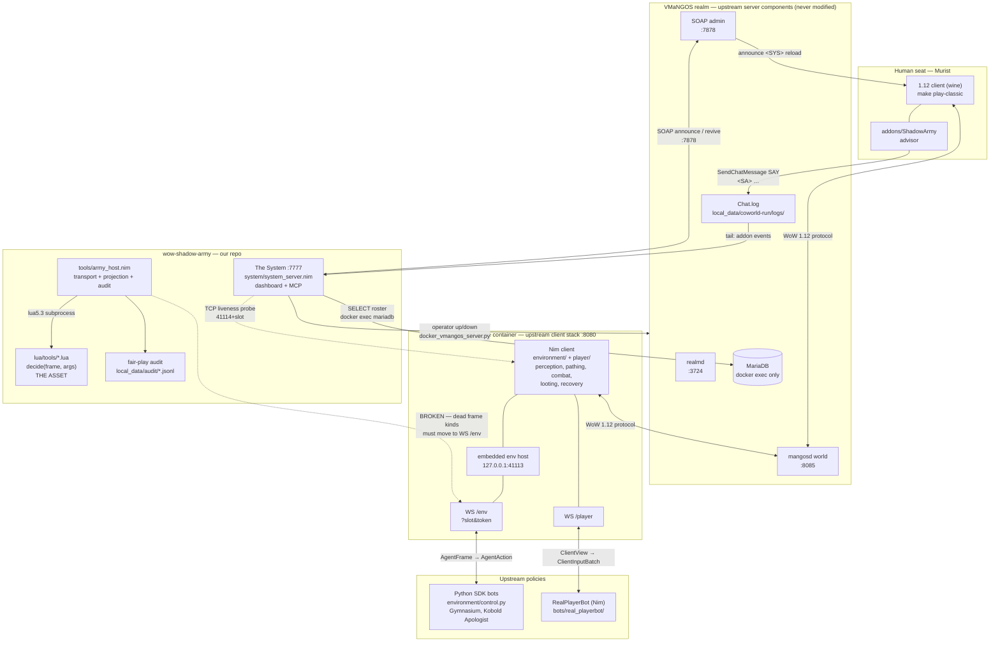

# Interfaces — how the realm, the clients, their bots, and our tools connect

One map of every boundary we touch. Upstream's client stack is large and moves
fast; this doc exists so we can tell, at a glance, **which of our things talk to
which of their things, over what** — and therefore what breaks when upstream
restructures again.

Terms are `docs/terms.md`. Protocol state as of pin `93730fb97` (2026-08-03).

## Two different clients — do not say "the client"

Every confusion in this area starts here. There are **two unrelated game
clients** in play, and almost nothing crosses between them:

| | **Nim client** | **vanilla 1.12 client** |
| --- | --- | --- |
| Who sits in it | bot seats (Shadowfel, Igris, Tusk, Beru) | the human seat (Murist) |
| What it is | upstream Nim code, headless, in the coworld-game container | real Blizzard `WoW.exe` under wine |
| Launched by | `make igris-bot` / `tusk-bot` / `beru-bot` | `make play-classic` |
| Our code inside it | **none** — we drive it from outside over `WS /env` | **the advisor addon** (`addons/ShadowArmy`, Lua 5.0) |
| Addons | not a thing | `Interface/AddOns/`, symlinked from our repo |

**The advisor runs in the vanilla client only.** It is not part of the bot
stack, never sees an `AgentFrame`, and has no connection to `army_host`. Our
Lua *bot* tools (`lua/tools/`) and our Lua *advisor* addon are two separate
bodies of Lua that never meet.

## The map



## Ports

| Port | Owner | Who talks to it |
| --- | --- | --- |
| `3724` | realmd | game clients (login) |
| `8085` | mangosd world | game clients (world) |
| `7878` | VMaNGOS SOAP admin | **The System** (announce, revive, tele) |
| `8080` | coworld-game HTTP/WS | `WS /env` (policies), `WS /player`, healthz |
| `41113` | embedded Nim env host | the `/env` relay forwards here (loopback) |
| `41114+slot` | legacy `nim_control` | **dead** — System still probes it for liveness |
| `7777` | The System | dashboard (htmx) + MCP endpoint |

## The two upstream policy contracts

Upstream owns two *different* boundaries. Do not confuse them —
`docs/bot-environment-contract.md` in the client repo is the authority.

| | `WS /env` | `WS /player` |
| --- | --- | --- |
| Contract | `act(AgentFrame) -> AgentAction` | `step(ClientView) -> ClientInputBatch` |
| Observation | flat semantic frame, MessagePack | rendered client view |
| Action | closed typed union | ordered physical key/mouse input |
| Users | Python SDK, Gymnasium, **and us** | RealPlayerBot |

`WS /env` is documented as *"the sole external policy transport."* **That is our
lane.** It is stock — it needs no fork patch, which is why the
`lua-external-policy` client patches are obsolete (`docs/work-2026-08-03.md`).

## Where our Lua bot fits

```text
AgentFrame (MessagePack, kind 10)
        │
        ▼
tools/army_host.nim ── projection ──▶ plain Lua table  (FROZEN CONTRACT)
        │                                   │
        │                          lua/tools/<tool>.decide(frame, args)
        │                                   │
        │                              named intent
        ▼                                   │
action_submission (JSON, kind 9) ◀── intent → typed AgentAction
```

`army_host` runs the Lua as a `lua5.3` subprocess with `package.path` pointed at
our `lua/` tree. **Lua never sees the wire.** That is deliberate and is the whole
defence against upstream churn:

> Every upstream coupling — frame kinds, `AgentFrame` shape, `AgentAction`
> union, auth — lives in the Nim adapter. The Lua-facing table shape is frozen.
> Upstream restructures hit one file and never reach `lua/`.

This is the `AGENTS.md` **Coupling isolation** rule. It is the reason the
1661-commit restructure cost us zero lines of Lua.

## Where our tools fit

**The System (`system/system_server.nim`, :7777)** — talks to the **server's
admin surfaces, not the game client**:

- **SOAP `:7878`** — in-game announce, addon reload broadcast, admin revive
- **MariaDB via `docker exec`** — character roster, SELECT-only
- **realm_op wrapper** (`tools/realm_op.sh`) — discovers upstream
  `docker_vmangos_server.py` (layout-resilient) and auto-adds `--build` when
  the game image lacks feature metadata; used by The System and Makefile
  — realm `up` / `down`
- **Chat.log tail** — reads addon events the advisor `/say`s
- **TCP probe on `41114+slot`** — liveness only ("is the seat up"), no protocol

So: yes, the dashboard is an **admin-plane** tool. Its only contact with a game
client is the liveness probe and the chat bus below.

**`tools/army_host.nim`** — the only thing that speaks the policy transport.
**One process per bot seat, four in total** — `escort-army` loops slots 2–5 and
launches four independent hosts, each with its own pid file and log:

```text
army_host --slot=2 --tool=escort_leader  → Shadowfel  → army-slot2.pid/.log
army_host --slot=3                       → Igris      → army-slot3.pid/.log
army_host --slot=4                       → Tusk       → army-slot4.pid/.log
army_host --slot=5                       → Beru       → army-slot5.pid/.log
```

One process ↔ one seat ↔ one socket ↔ one Lua tool. They share **no state** —
which is what makes fair play structurally true rather than a promise: a seat
can only learn about another seat through the game's own party contracts. The
only shared artifact is the append-only audit file.

What one instance does each tick:

1. connect to its seat (`connectClient`)
2. install a typed goal (`submitGoal`), hold/resume/cancel (`sendDirective`)
3. poll status + environment frame at `--cadence` (default 0.35s)
4. project the frame into a flat Lua table (`projectV2`)
5. run `lua/tools/<tool>.decide` in a `lua5.3` subprocess (`runDecide`)
6. lower the returned intent to a typed action (`mapIntentV2`) and fire it
7. apply guards and watchdogs — pet-swing detection, stuck-combat, far-move
   sanity, stale-revision retry, zero-displacement streak limits
8. append fair-play milestones to the audit stream

It has two modes — default goal-install, and `--external` where Lua drives
every action. **Both are dead against the new pin**: goal mode lost `FrameGoal`,
external mode lost `execute_action`.

**`addons/ShadowArmy`** (the advisor) — runs *inside* the human's 1.12 client.
Vanilla 1.12 has **no HTTP client**, so it has no direct link to The System.
The loop goes through the server both ways:

```text
advisor  ──SendChatMessage SAY──▶ world ──▶ Chat.log ──tail──▶ The System
The System ──SOAP announce──▶ world ──▶ client chat ──▶ advisor reacts
```

That is why the realm must be up for `reload_addon` to work, and why a reload is
confirmed by a fresh `<SA> loaded rev=…` line rather than an HTTP response.

## What interfaces with which client

| Our thing | Nim client (bot seats) | vanilla 1.12 client (human) | State |
| --- | --- | --- | --- |
| `tools/army_host.nim` | policy transport (`WS /env`) | — | **needs porting** |
| `lua/tools/*.lua` | only via `army_host` | — | working |
| `addons/ShadowArmy` | — | runs **inside** it | working |
| The System | TCP liveness probe `41114+slot` | indirectly, SOAP → server chat | working |

Nothing of ours runs inside the Nim client, and nothing of ours reaches the
vanilla client except through the server's chat bus.

## Current state

- **Working:** the whole Lua tool library and its tests, our Nim tools, The
  System and all its admin paths, the advisor, the realm, and the upstream
  client build.
- **Broken:** the one arrow from `army_host` to the client. Frame kinds
  1/2/4/5/6/7 were deleted upstream and 9 was repurposed, while the protocol
  version stayed `2` — so it fails quietly.
- **Fix:** port `army_host` to `WS /env`. No client changes. Detail and open
  questions in `docs/work-2026-08-03.md`.

## How to regenerate

```bash
# our side
grep -nE "7777|7878|41114|SOAP|Chat.log|docker exec|OperatorScript" system/system_server.nim
grep -nE "Frame[A-Za-z]+ *= *[0-9]+'u16|package.path|lua5.3" tools/army_host.nim
grep -nE "SendChatMessage|F.say|no HTTP client" addons/ShadowArmy/ShadowArmy.lua

# upstream side (read-only)
sed -n '1,20p'  ../coworld-vanilla-wow/environment/control_wire.nim
sed -n '1,30p'  ../coworld-vanilla-wow/docs/bot-environment-contract.md
sed -n '40,90p' ../coworld-vanilla-wow/docs/coworld-network-transport.md
```
